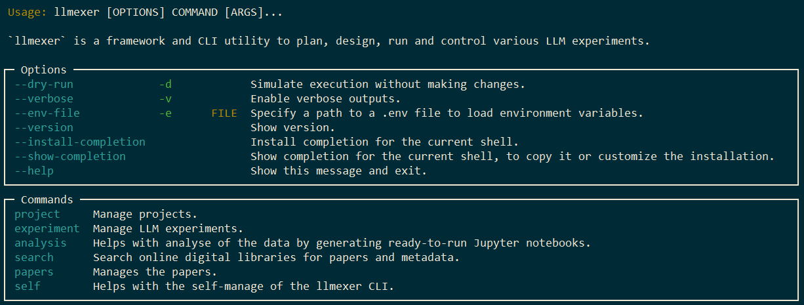
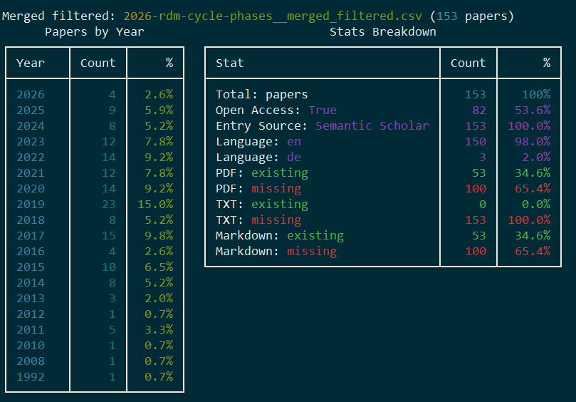
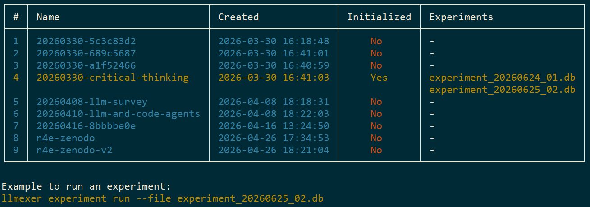
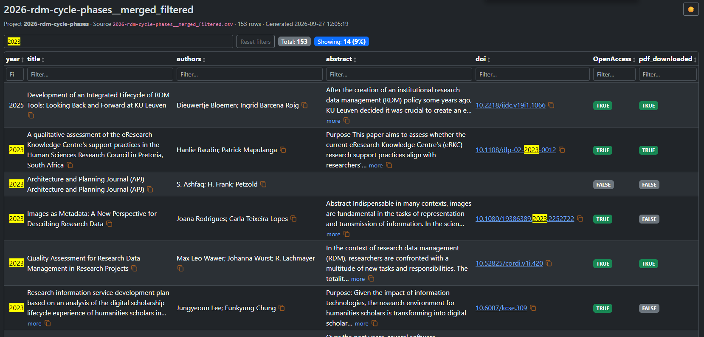
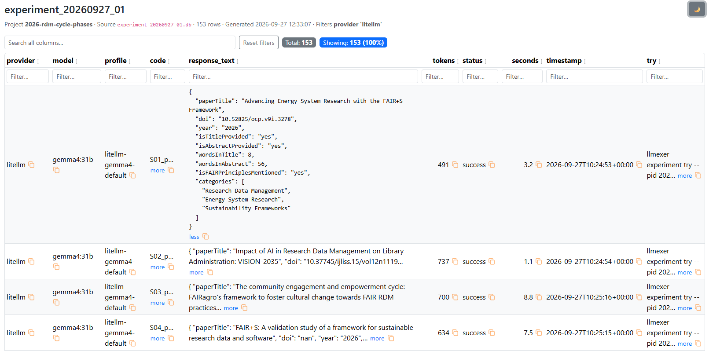

## 🔰About


`llmexer` is a CLI tool for LLM experiments. Use it to build datasets (publications, metadata, prompts) and to design, run and evaluate experiments on them.

> 🪄 The idea behind the tool: `everything` is a `file`. Projects, experiments, searches, and configs are all stored as files. The CLI edits them for you, but you can also edit them manually. Anything could be changed or viewed via the files—a model name, a search string, a new PDF, or the generated SQLite database.

## 💎 Core features

- **Easy start**: `llmexer` is a Python package that can be installed and run anywhere.
- **Transparency**: each project keeps related files in one folder (e.g., experiments, papers, searches, analysis, etc.) using plain formats (CSV, text, SQLite). Add these files to git and track progress and retain history.
- **Literature search and papers**: search Semantic Scholar and OpenAlex, download papers by DOI, extract text from PDFs as markdown.
- **Experiment design**: combine data with custom and configurable LLM prompts, LLM models and LLM parameter into one reproducible experiment.
- **Multiple LLM providers**: run the same experiment using different LLMs (supports: `ollama`, `vLLM`, `LiteLLM`, `OpenAI`, and `OpenRouter`).
- **Controlled runs**: run experiment in parallel to save time, test prompts using `experiment try` to find a proper prompt, add new LLM configurations ad-hoc.
- **Results and export**: view stats per model and provider, export search and experiment results to HTML reports for ad-hoc analysis.
- **Analysis**: generate Jupyter notebooks using pre-defined templates. It help with analysis of search and LLM experiments (e.g., measure agreement between LLMs with Cohen's kappa).

## ✨ Early `beta` warning

The package is in early beta. Breaking changes may arrive at short notice.

## 📦 Installation

Install with `pip`:
```bash
pip install --upgrade llmexer
```

Install with `uv`:
```bash
uv pip install --upgrade llmexer
```

Then set up your configuration, as described below.

## 🏁 Documentation

The current readme is used as documentation.

[Documentation](https://vdmitriyev.github.io/llmexer/)

## 🔗 Tutorials and articles

* [llmexer Tutorial - From a Literature Search to Reproducible LLM Experiments with Search Results](https://vdmitriyev.github.io/blog/llmexer-tutorial-from-a-literature-search-to-reproducible-llm-experiments-with-search-results.html)

## ⚙️ Configuration

`llmexer` needs access to a local or remote LLM. It reads your credentials and your current project from a `.env` file.

Create a `.env` file in the project root and add the settings you need. All of them are optional.

**Current project**
```env
PROJECT_ID=20260330-3a9adf70
```

To use a different set of variables for one run, pass your own file:
```bash
llmexer --env-file custom.env
```

## 🪸 `.env` Configurations

Every variable below is optional unless marked **required**.

Provider category: **ollama**

| NAME | Default | Explanation |
|---|---|---|
| `PROVIDER_OLLAMA_URL` | `http://localhost:11434/v1` | Base URL of the local Ollama server. |

Provider category: **vllm**

| NAME | Default | Explanation |
|---|---|---|
| `PROVIDER_VLLM_URL` | `http://localhost:8000/v1` | Base URL of the local vLLM server. |

Provider category: **openai**

| NAME | Default | Explanation |
|---|---|---|
| `PROVIDER_OPENAI_URL` | *none* — **required** | Route the `openai` provider from anywhere. |
| `PROVIDER_OPENAI_KEY` | `na` placeholder | API key for the `openai` provider. |

Provider category: **gemini**

| NAME | Default | Explanation |
|---|---|---|
| `PROVIDER_GEMINI_URL` | `https://generativelanguage.googleapis.com/v1beta/openai/` | Gemini's OpenAI-compatible endpoint |
| `PROVIDER_GEMINI_KEY` | `na` placeholder | API key for the `gemini` provider. |

Provider category: **litellm**

| NAME | Default | Explanation |
|---|---|---|
| `PROVIDER_LITELLM_URL` | *none* — **required** | [LiteLLM](https://docs.litellm.ai/) proxy endpoint |
| `PROVIDER_LITELLM_KEY` | *none* — **required** | The proxy always authenticates|

Provider category: **openrouter**

| NAME | Default | Explanation |
|---|---|---|
| `PROVIDER_OPENROUTER_URL` | `https://openrouter.ai/api/v1` | [OpenRouter](https://openrouter.ai/) gateway, which fronts many upstream providers behind one endpoint |
| `PROVIDER_OPENROUTER_KEY` | *none* — **required** | The gateway always authenticates|
| `PROVIDER_OPENROUTER_MAX_SPEND` | `5.0` (USD) | Ceiling on what **one** `experiment run` may spend through OpenRouter. Re-run will reset budget counter, so it caps per run/session, not cumulative.|

Provider variables follow one naming rule: `PROVIDER_<PROVIDER-NAME>_URL` or `PROVIDER_<PROVIDER-NAME>_KEY` (`<PROVIDER-NAME>` is the provider in uppercase`OLLAMA`, `VLLM`, `LITELLM`, `OPENAI`, `GEMINI` or `OPENROUTER`).

Category: **search**

| NAME | Default | Explanation |
|---|---|---|
| `OPENALEX_API_KEY` | *unset* | Turns on the OpenAlex engine of `search run`. Unset, OpenAlex is skipped. |
| `CORE_API_KEY` | *unset* | Turns on the CORE engine of `search run` (free key from core.ac.uk). Unset, CORE is skipped. |
| `NCBI_API_KEY` | *unset* | Optional for PubMed: raises NCBI's limit from 3 to 10 requests per second. |
| `ZENODO_API_KEY` | *unset* | Optional for Zenodo: a personal access token raises the page size from 25 to 100 records and the rate limit. |
| `OPEN_ALEX_MAX_RESPONSES` | `5000` | Cap on the works processed per OpenAlex query. Called `MAX_OPEN_ALEX_RESPONSES` before 0.6.2; the old name still works, with a warning. |
| `CORE_MAX_RESPONSES` | `5000` | Cap on the works processed per CORE query. |
| `SEARCH_MAX_RESPONSES` | `5000` | Cap on the records processed per Europe PMC, PubMed, arXiv or Zenodo query. |
| `UNPAYWALL_EMAIL` | `llmexer.openalex@local.local` | Contact address for DOI downloads via Unpaywall, the OpenAlex polite-pool `mailto`, and the `email` sent to PubMed. |

Category: **docling**

| NAME | Default | Explanation |
|---|---|---|
| `DOCLING_URL` | `http://localhost:5001/` | Remote `docling-serve` used by `papers extract --processor docling`. |
| `DOCLING_USER` | *empty* | Username for the docling server. |
| `DOCLING_PASSWORD` | *empty* | Password for the docling server. |

Category: **CLI**

| NAME | Default | Explanation |
|---|---|---|
| `LLMEXER_BASEDIR` | `basedir` in `llmexer.ini` | Where the CLI writes `.projects/` and `temp/`. |
| `LLMEXER_PROJECTS_DIR` | `.projects` | Name of the projects folder inside the basedir. |
| `LLMEXER_EXPERIMENTS_DIR` | `experiments` | Name of the folder inside each project that holds its experiment(s). It was `experiment` before 0.6.0. |
| `LLMEXER_SEARCH_ENGINES` | `search_engines` in `llmexer.ini` | The search engines `search run` uses by default, comma-separated (see [CLI category: search](#-cli-category-search)). |

### Where llmexer keeps its data

`llmexer` no longer writes into the folder you start it from. On the first run it creates a `.llmexer/` folder with an `llmexer.ini` file and the `llmexer.log` log file:

- **Inside a virtualenv**: in the folder that holds the virtualenv (for `myproj/.venv`, that is `myproj/.llmexer/`). The default `basedir` is that same folder, written as `.`. Relative paths are resolved against it.
- **Without a virtualenv**: in your home folder (`~/.llmexer/`). The default `basedir` is your home folder, and it must be an absolute path.

```ini
[llmexer]
basedir = .
projects_dir = .projects
experiments_dir = experiments
search_engines = semantic_scholar, openalex, core
```

> ⚠️ **Upgrading from 0.5.x:** the experiment folder of a project is now called `experiments/` (it was `experiment/`)

`search_engines` is the default list of search engines for `search run`; see [CLI category: search](#-cli-category-search). An `llmexer.ini` created before 0.6.2 has no such line and uses the default above.

`LLMEXER_BASEDIR`, `LLMEXER_PROJECTS_DIR`, `LLMEXER_EXPERIMENTS_DIR` and `LLMEXER_SEARCH_ENGINES` override these values. Set them in the shell, in a `.env` file in the current folder, or in a file passed with `--env-file`. Run `llmexer self paths` to see the paths in use.

## 🚀 Getting started

This is the usual path from an empty project to analysed results.

**1. Create a project**
```bash
llmexer project create
```

**2. Give it a meaningful name**
```bash
llmexer project rename --old-id 20260402-a1b2c3d4 --new-id llm-survey-2026
```

**3. Set up the project structure**

This creates an `experiments/` folder with template CSVs and a starter prompt:
```bash
llmexer experiment init --pid llm-survey-2026
```

| File | What it holds |
| :-------- | :---------- |
| `experiments/llms-for-experiment.csv` | The models to test. One row is one model run under one profile, so list a model twice to run it under two profiles. |
| `experiments/data.csv` | Your input rows. |
| `experiments/mapping.csv` | Which prompt each data row uses. |
| `experiments/llm-params.csv` | Hyperparameter profiles, keyed by provider, model and profile name. |
| `experiments/prompts/prompt01.txt` | A starter Jinja2 prompt template using `{{title}}` and `{{abstract}}`. |

**4. Build the experiment database**

First fill in the CSVs and write your prompt templates. Then pair the data rows with the prompts you want:
```bash
llmexer experiment map --pid llm-survey-2026 --prompt prompt01,prompt02
```

`map` is optional, and most useful after `experiment copy-papers` or `experiment copy-search` has replaced your `data.csv`. It pairs every data row with every prompt you select and backs up the old `mapping.csv`.

Now generate the experiments:
```bash
llmexer experiment generate --pid llm-survey-2026
```

`generate` renders every combination of data row, prompt, model and parameter profile, then writes them to a SQLite database in `experiments/`. Models and profiles are matched on provider, model name and profile name. Each of those combinations must be unique in each CSV; if one is repeated, `generate` reports it and stops. A model with no matching profile is reported and skipped.

Add `--dry-run` to see how many rows you would get, without writing anything:
```bash
llmexer --dry-run experiment generate --pid llm-survey-2026
```

> 💡 **Hint:** the experiment store is a plain SQLite database (`experiments/experiment_*.db`), so you can also open and edit it in a tool such as [DBeaver](https://dbeaver.io/). Each provider has an `experiment_<provider>` table for the rows and a `params_<provider>` table for the hyperparameters. Join them to see each row next to the parameters it ran with:
>
> ```sql
> SELECT e.*, p.* FROM experiment_ollama e
> JOIN params_ollama p
>   ON e.params_code = p.params_code AND e.profile_name = p.profile_name;
> ```

**5. Add later combinations to the database (optional)**

If you add a model, a profile or a few mapping rows after generating, `update` appends what is missing instead of starting a new database:
```bash
llmexer experiment update --pid llm-survey-2026
```

Stored rows and the results already collected for them are never touched.

Hyperparameters are never rewritten either. If a profile keeps its name but has different values, `update` reports the differences and stops — otherwise you could not tell rows generated before the change from rows generated after it. Give the changed parameters a new profile name, point the model row at it, and run `update` again. A changed prompt or data cell is only reported as a warning, and the stored rows keep the text they were generated with.

**6. Try one combination (optional)**

Before running everything, check what one prompt returns for one data row under one profile:
```bash
llmexer experiment try --pid llm-survey-2026 \
  --prompt prompt01 --profile ollama-default --data-id D01
```

`try` is `generate` and `run` for a single combination. It checks all three names first, so a typo stops the command before any LLM call. The model and provider come from the profile; if one profile name covers several models, `try` lists them and asks you to add `--model` or `--provider`. Every try is kept as history in the database, together with the parameters it used, and leaves your generated rows and their results alone. A project that has not been generated yet has no database to keep it in: the try then warns, runs anyway and saves only the response file.

Not sure what to try? `--suggest` picks a data row, a prompt and a model at random from `data.csv`, `prompts/` and `llms-for-experiment.csv`, and prints the command for that combination without running it:

```bash
llmexer experiment try --pid my-project --suggest
```

Add `--dry-run` to print the rendered prompt without calling anything.

**7. Run the experiment**

Call the LLMs and collect the results:
```bash
llmexer experiment run --pid llm-survey-2026 --file experiment_<SAMPLE>.db
```

Results are written back into the same database, so it stays your single source of truth. Each call is also saved as a JSON file in `experiments/responses/`. If you run the command again, rows that already finished successfully are skipped.

[Scenario 4](#-scenario-4-more-ways-to-run-an-experiment) covers the rest of the options: previewing a run, narrowing it to one provider, model or profile, running a single row, and running several calls at once.

**8. Check the statistics**
```bash
llmexer experiment stats --pid llm-survey-2026
```

You get totals, token counts, and a breakdown per provider and per model. If the project holds several databases, pass `--file` to choose one:
```bash
llmexer experiment stats --pid llm-survey-2026 --file experiment_<SAMPLE>.db
```

**9. Export the results as HTML (optional)**

This renders the experiment as one self-contained page, which is handy for screening or sharing:
```bash
llmexer experiment export --pid llm-survey-2026 --file experiment_<SAMPLE>.db
```

The page has sortable columns, per-column filters and a copy button on every cell. Each row also carries a ready-to-run `experiment try` command, so you can copy a cell and re-run that single combination in a shell.

You can also export part of a database, with the same filters `experiment run` takes:
```bash
llmexer experiment export --pid llm-survey-2026 --filter-provider ollama
```

Two more filters belong to the export alone and match a pattern instead of one value. `--filter-code` is a glob over the row `code`, and `--filter-response` a regular expression over the answer — both case-insensitive:
```bash
llmexer experiment export --pid llm-survey-2026 --filter-code 'S12_*'
llmexer experiment export --pid llm-survey-2026 --filter-response '"relevant":\s*true'
```

The glob has to cover the whole code, so write `S12_*` rather than `S12`. The regular expression is searched anywhere in the stored answer (filter no yer run rows - `--filter-response '^$'`).

**10. Compress the database (optional)**

A finished database is easier to share or keep once it is packed. The archive is written next to the database under the same name, and the database itself stays where it is:
```bash
llmexer experiment compact --pid llm-survey-2026 --file experiment_<SAMPLE>.db
```

P.S. This option is just for convenience. You can achieve the same results faster by using the archive program native to your operating system.

**11. Analyse the results in a notebook (optional)**
```bash
llmexer analysis init --pid llm-survey-2026
```

This creates an `analysis/` folder with two notebooks and the Python modules they call. Open `analyse_experiment.ipynb` and run all cells: it loads the experiment database, parses each model answer from JSON into its own columns, exports those answers as a CSV, and prints the statistics and charts. `analyse_searches.ipynb` does the same for one search.

The modules are copies, so each project can grow its own analysis. The notebooks import only those copies and never `llmexer`, so the folder stands on its own. To restore the shipped versions, run `llmexer analysis init --rewrite`; your copies are backed up first.

Running the notebooks needs the optional analysis packages:
```bash
uv pip install -e . --group analysis
```

> 💡 The CLI has many more options than this guide shows. Run `llmexer --help`, or `llmexer <category> <command> --help`, to see them all.

## ✏️ CLI UI

An overview of the CLI:
```bash
llmexer --help
```



The statistics of a search, shown in the terminal:
```bash
llmexer search stats --file <filename>
```


Your projects, with the current one highlighted:
```bash
llmexer experiment list
```


Search results exported as a static HTML page, which makes screening easier (shown in `darkmode`):
```bash
llmexer search export
```



Experiment results exported as a static HTML page (filtered by provider), which makes screening easier:
```bash
llmexer experiment export --filter-provider litellm
```



## 💡 Additional: Rename PDFs with `pdf-renamer`

Before you add papers to a project, you can rename them by their bibliographic metadata — year, journal, authors and title — with the external [`pdf-renamer`](https://github.com/MicheleCotrufo/pdf-renamer) tool. You do not need to install it; run it with `uvx`.

Rename as year, authors, title:
```bash
uvx --from pdf-renamer pdfrenamer -f "{YYYY}_{A3etal}_{T}" /path/to/pdfs
```

Include subdirectories:
```bash
uvx --from pdf-renamer pdfrenamer /path/to/pdfs -sf
```

## 💡 Additional: Extract BibTeX

You can also extract the BibTeX entry of a publication:
```bash
uvx --from pdf2bib pdf2bib -s bibtex.bib /path/to/pdfs
```

## 📢 Scenario 1: Add papers to a project

From a local file:
```bash
llmexer papers add --pid llm-survey-2026 --file ~/Downloads/attention-is-all-you-need.pdf
```

From a directory of PDFs:
```bash
llmexer papers add --pid llm-survey-2026 --directory ~/Downloads/papers/
```

From a URL:
```bash
llmexer papers add --pid llm-survey-2026 --url https://arxiv.org/pdf/1706.03762
```

## 📢 Scenario 2: Collect data by running a literature search

**1. Run a search**

Create a search configuration, then run it:
```bash
llmexer search create --pid llm-survey-2026 --query "large language models"
llmexer search list --pid llm-survey-2026
llmexer search run --pid llm-survey-2026 --file 20260401-bfdd863d.yaml
```

Or run a query directly:
```bash
llmexer search run --pid llm-survey-2026 --query "large language models" --limit 500
```

To search more engines, list them in the search file. The free biomedical and preprint engines are off by default:
```bash
llmexer search create --pid llm-survey-2026 --query '"large language models" AND diagnosis'
# edit searches/<ID>.yaml:  engines: [semantic_scholar, europepmc, pubmed, arxiv]
llmexer search run --pid llm-survey-2026 --file <ID>.yaml --limit 500
```

To use them in every new search, set `search_engines = semantic_scholar, openalex, core, europepmc, pubmed, arxiv` in `.llmexer/llmexer.ini` instead.

Results are saved as `<ID>__results.csv` in `searches/`.

**2. Filter out rows you do not need (optional)**

`filter` removes rows and writes `<ID>__filtered.csv`. Filters chain: each run reads the existing filtered file, or the results file if there is none, and rewrites it. You can combine `--language`, `--source`, `--doi` and `--downloaded` in one run:
```bash
# drop German rows, and rows that are not downloaded yet
llmexer search filter --pid llm-survey-2026 --file 20260401-bfdd863d.yaml --language de --downloaded
```

Leave out `--file` to apply the same filters to every search in the project. Each applied filter is logged, so you can see later what was removed.

**3. Export search results as HTML (optional)**
```bash
llmexer search export --pid llm-survey-2026 --file 20260401-bfdd863d.yaml
```

This writes an HTML page next to the CSV, with sortable columns, per-column filters, clickable DOIs and collapsible abstracts. Leave out `--file` to export every search.

## 📢 Scenario 3: Download papers and extract their text

**1. Download open-access papers by DOI**

`llmexer` uses the Unpaywall API, which needs your email address:
```bash
llmexer papers download --pid llm-survey-2026 --doi 10.1038/nature12373 --email you@example.com
```

You can also download every paper with a DOI from a search result file:
```bash
llmexer papers download --pid llm-survey-2026 --search-file 20260401-bfdd863d__results.csv
```

Or from a filtered file, to download only the papers that passed your filters:
```bash
llmexer papers download --pid llm-survey-2026 --search-file 20260401-bfdd863d__filtered.csv
```

Failed downloads are written to a CSV in `searches/logs/`, so you can retry them. When the download finishes, the search is synced against your `papers/` folder: the listed rows are updated, and no new rows are added.

**2. Extract text from the papers**

The default `pypdf` backend saves `.txt` files:
```bash
llmexer papers extract --pid llm-survey-2026
```

The `docling` backend gives richer Markdown output and saves `.md` files. It reads its connection details from `.env`:
```bash
llmexer papers extract --pid llm-survey-2026 --processor docling
```

You can also pass those details directly:
```bash
llmexer papers extract --pid llm-survey-2026 --processor docling \
  --docling-url http://myserver:5001/ \
  --docling-user admin \
  --docling-password secret
```

Papers that already have an extracted file are skipped. Use `--rewrite` to extract them again:
```bash
llmexer papers extract --pid llm-survey-2026 --rewrite
```

## 📢 Scenario 4: More ways to run an experiment

**1. Preview a run without calling any LLM**
```bash
llmexer --dry-run experiment run --pid llm-survey-2026
```

**2. Run the rows of one provider**

This helps when only one backend is available, such as a local ollama:
```bash
llmexer experiment run --pid llm-survey-2026 --filter-provider ollama
```

**3. Run one model or one profile**

Both names must match in full, and they are case-sensitive:
```bash
llmexer experiment run --pid llm-survey-2026 --filter-model gemma4:31b
```

```bash
llmexer experiment run --pid llm-survey-2026 --filter-profile ollama-creative
```

You can also combine the filters:
```bash
llmexer experiment run --pid llm-survey-2026 --filter-provider ollama --filter-model gemma4:31b
```

**4. Run a single row by its code**
```bash
llmexer experiment run --pid llm-survey-2026 \
  --file experiment_<SAMPLE>.db --code 1
```

**5. Run several LLM calls at once**

Most of a run is spent waiting for the backend, so `--parallel-calls` lets several calls run at the same time. The limit applies across all providers, and the default is `1`, which runs the rows one after another. Results are always written one at a time.
```bash
llmexer experiment run --pid llm-survey-2026 --parallel-calls 4
```

## 📢 Scenario 5: Several experiments in one project

Sometimes one search feeds more than one experiment. For example, you may want to screen the abstracts with one set of models and the full papers with another. Each sub-experiment then needs its own data, but the prompts and parameter profiles can stay the same. Create the project with `--layout multiple`:

```bash
llmexer experiment init --pid llm-survey-2026 --layout multiple --exp abstracts --exp fulltext
```

```
experiments/
├── experiments.yaml        # lists the sub-experiments and the default one
├── llm-params.csv          # shared
├── prompts/                # shared
├── abstracts/              # data.csv, mapping.csv, llms-for-experiment.csv,
│                           # experiment_*.db, responses/
└── fulltext/
```

Every experiment command takes `--exp NAME`. Without it, the `default` sub-experiment from `experiments.yaml` is used (the first `--exp` given to `init`):

```bash
llmexer experiment copy-search --pid llm-survey-2026 --exp abstracts --file <SEARCH_ID>__results.csv
llmexer experiment copy-papers --pid llm-survey-2026 --exp fulltext
llmexer experiment generate --pid llm-survey-2026 --exp fulltext
llmexer experiment run --pid llm-survey-2026 --exp fulltext
```

`init` and `add` also accept your own files with `--data`, `--mapping` and `--llms`. The files are copied in under the standard names:

```bash
llmexer experiment add papers-gpt --pid llm-survey-2026 --from fulltext --llms my-llms.csv --default
```

To turn an existing project into one with several experiments, name its current experiment. Its data, mapping, LLM list, databases and `responses/` move into `experiments/<name>/`:

```bash
llmexer --dry-run experiment convert --pid llm-survey-2026 --exp abstracts   # shows what moves
llmexer experiment convert --pid llm-survey-2026 --exp abstracts
```

`analysis init --exp NAME` and `analysis add-agreement --exp NAME` write notebooks with a `<NAME>__` prefix, so each sub-experiment gets its own.

## 📢 Scenario 6: Draw a PRISMA 2020 flow diagram

This scenario continues Scenario 5. The `abstracts` sub-experiment screens the search results, and `fulltext` checks the papers that pass. For the screening boxes, each prompt must ask for a yes/no field in its JSON answer, for example `{"include": "yes", "reason": "..."}`.

**1. Look at the numbers first**

`--dry-run` prints every PRISMA box with its number and where the number comes from. It writes nothing:
```bash
llmexer --dry-run analysis draw-prisma --pid llm-survey-2026
```

Without `--field`, only the identification boxes are filled: records per database, duplicates, and records removed by `search filter`. The other boxes show `n = ?`.

**2. Add the screening decisions**

`--field` names the yes/no field. `--llm-vote-rule` combines the models' answers for each paper:
- `majority` (the default) keeps a paper if most answers are yes; a tie keeps it.
- `any` keeps it if one answer is yes.
- `all` excludes it if one answer is no.

```bash
llmexer analysis draw-prisma --pid llm-survey-2026 --exp abstracts --field include --llm-vote-rule majority
```

By default every answer in the experiment counts. To leave out a pilot prompt or a weak model, name the ones that should count. Each option can be repeated or take a comma-separated list:
```bash
llmexer analysis draw-prisma --pid llm-survey-2026 --exp abstracts --field include \
  --prompt screening_v2 --filter-model gpt-4o,gemma4:31b
```

`--filter-provider`, `--filter-model` and `--filter-profile` apply to both stages; `--prompt` applies to screening and `--fulltext-prompt` to the full-text stage.

**3. Add the full-text stage**

```bash
llmexer analysis draw-prisma --pid llm-survey-2026 --exp abstracts --field include \
  --fulltext-exp fulltext --fulltext-field include --reason-field reason \
  --title "LLM survey 2026"
```

This writes three files to `analysis/`:
- `abstracts__prisma.svg`: the diagram.
- `abstracts__prisma_counts.yaml`: the options you used (`settings`), the files read, and every number with its source.
- `abstracts__prisma_decisions.csv`: one row per paper and stage, with the votes, the LLM decision and the final decision.

The command remembers its options. Next time, `llmexer analysis draw-prisma --pid llm-survey-2026 --exp abstracts` is enough. Pass an option to change it, or `--ignore-settings` to start again.

**4. Check papers by hand**

To overrule the LLMs for a paper, open the decision file and write `yes` or `no` in its `manual` column. At the full-text stage, `manual_reason` sets the exclusion reason. Run the command again: the counts use your decision, and the `manual` columns are kept on every run.

```
stage;data_id;title;yes;no;unusable;llm_decision;llm_reason;manual;manual_reason;decision
screening;S02;...;1;2;0;excluded;;yes;;kept
fulltext;S04;...;0;3;0;excluded;Wrong population;no;Wrong outcome;excluded
```

**5. Correct a number by hand**

If a total is wrong or missing, set it under `overrides` in the counts file and run the command again. Your overrides are kept on every run:
```yaml
overrides:
  not_retrieved: 3
  excluded_reasons: {Wrong population: 12, No LLM used: 7}
```

When a run changes any of the three files, the old one is first copied to `analysis/.backup/`.

**6. Check the numbers in a notebook (optional)**

```bash
llmexer analysis add-prisma --pid llm-survey-2026 --exp abstracts
```

`analysis/abstracts__analyse_prisma.ipynb` takes the saved settings, shows each stage and the papers the models disagree on, then draws the same SVG. It reads and writes the same three files as `analysis draw-prisma`.

#### Working with the current project

Most commands take a `--pid` option to say which project to use. If you set `PROJECT_ID` in your `.env` file, you can leave it out:

```bash
# in .env
PROJECT_ID=my-project

# uses my-project
llmexer search run --query "machine learning"
```

Pass `--pid` to override it for a single command:
```bash
llmexer search run --pid different-project --query "deep learning"
```

## 🗂️ CLI category: **project**

A project is the top-level container for your experiments, papers and searches. The `project` category (alias: `proj`) manages them.

| Command   | What it does | Example |
|-----------|-------------|-----------------|
| `create` | Creates a project folder under `.projects/`. Takes an optional custom ID. | `llmexer project create --id my-project` |
| `current` | Shows the current project ID from `.env`. | `llmexer project current` |
| `list` | Lists every project under `.projects/` with the parts it holds (search, experiment, analysis, papers) and its creation date. Supports `--sort-by` and `--desc`. | `llmexer project list --sort-by date` |
| `rename` | Renames a project. Uses `PROJECT_ID` from `.env` if you leave out `--old-id`. | `llmexer project rename --old-id old-name --new-id new-name` |

## 🧪 CLI category: **experiment**

The `experiment` category (alias: `exp`) sets up, generates and runs the experiments inside a project. In a project with several sub-experiments, every command below takes `--exp NAME`, falling back to the default named in `experiments.yaml`.

| Command   | What it does | Example |
|-----------|-------------|-----------------|
| `init` | Creates the `experiments/` folder with template CSVs and a starter prompt. Stops if the project is already set up. `--layout multiple --exp NAME` (repeatable) creates named sub-experiments that share `llm-params.csv` and `prompts/` (see Scenario 5). `--data`, `--mapping` and `--llms` copy in your own files instead of the templates. | `llmexer experiment init --pid my-project --layout multiple --exp abstracts --exp fulltext` |
| `add` | Adds a sub-experiment to a project with several. Its files come from `--data` / `--mapping` / `--llms`, from another sub-experiment (`--from`), or from the templates. `--default` makes it the default. Supports `--dry-run`. | `llmexer experiment add fulltext --pid my-project --from abstracts` |
| `convert` | Turns a single-experiment project into one with several: everything except `llm-params.csv` and `prompts/` moves into `experiments/<exp>/`. Supports `--dry-run`. | `llmexer experiment convert --pid my-project --exp abstracts` |
| `copy-papers` | Copies the extracted text of your papers into `data.csv`, one row per paper. Backs up the old file first. | `llmexer experiment copy-papers --pid my-project` |
| `copy-search` | Copies a search result CSV into `data.csv` as `ID;Title;Abstract;year;doi;authors`, keeping the original row order. Backs up the old file first. | `llmexer experiment copy-search --pid my-project --file <SEARCH_ID>__results.csv` |
| `map` | Rebuilds `mapping.csv` by pairing every data row with the prompts you select. Use `--prompt` to pick them, or leave it out to use all of them. An unknown prompt name stops the command. Backs up the old file first. Supports `--dry-run`. | `llmexer experiment map --pid my-project --prompt prompt01,prompt02` |
| `generate` | Renders every combination of data row, prompt, model and parameter profile into a new SQLite database. A model without a matching profile is skipped, and a repeated combination stops the command before anything is written. Supports `--dry-run`. | `llmexer experiment generate --pid my-project` |
| `update` | Appends new combinations to an existing database instead of generating a new one. Stored rows and their results stay as they are. A profile whose values changed under the same name stops the command; rename the profile and run it again. Supports `--dry-run` and `--file`. | `llmexer experiment update --pid my-project` |
| `try` | Renders and runs one combination of data row, prompt and profile, then prints the answer. All three names are checked first, so a typo stops the command before any LLM call. Each try is kept as history, with the parameters it used. With no generated database the try warns and still runs, storing only the response file. `--suggest` prints one randomly chosen combination as a ready command and runs nothing. Supports `--dry-run`. | `llmexer experiment try --pid my-project --prompt prompt01 --profile ollama-default --data-id D01` |
| `fix` | Rewrites the stored answers, one named fix per run. As long as it directly modifies and saves database file, it could take while for a big database to get fixed (e.g., 3.5K rows in a minutes could be fixed). a Option `--ensure-json-format` repairs an answer that holds JSON wrapped in a fence or followed by an explanation, so the whole cell parses as JSON again. Option `--rename-json-field OLD NEW` renames a top-level field of that JSON, for a prompt whose wording changed after part of the experiment had run (first runs with `--ensure-json-format`). Every change is logged in the `datafix_logs`. Nothing is written unless you pass `--apply` (without it, `--test N` shows how many proposed changes could be fixed). Supports `--file` and `--dry-run`. | `llmexer experiment fix --pid my-project --ensure-json-format --apply` |
| `run` | Runs every row of a generated database against its provider and writes the results back into the same database. Rows that already finished are skipped. Narrow the run with `--filter-provider`, `--filter-model`, `--filter-profile` or `--code`, and raise the throughput with `--parallel-calls`. Supports `--dry-run` and `--file`. | `llmexer experiment run --pid my-project --filter-provider ollama` |
| `stats` | Shows the totals, token counts, and a breakdown per provider and per model. The same model served by two providers is reported once per provider. Pass `--file` to pick a database. | `llmexer experiment stats --pid my-project` |
| `view` | Shows the setup files of an experiment as tables (alias: `show`). `--params` shows `llm-params.csv` - one table per provider, `--llms` shows `llms-for-experiment.csv`. `--data` shows the counts related to data files. | `llmexer experiment view --pid my-project --llms` |
| `list` | Lists all projects with their setup state and their experiment databases, one row per sub-experiment (`*` marks the default). Sort with `--sort-by` and `--desc`. | `llmexer experiment list --sort-by date --desc` |
| `export` | Renders an experiment database as an HTML page next to it, with sortable columns, per-column filters and a ready-to-run `try` command per row. Narrow it with `--filter-provider`, `--filter-model` or `--filter-profile`, and with the export-only patterns `--filter-code` (glob over the code) and `--filter-response` (regular expression over the answer); each filter is added to the file name. Supports `--file`, `--rewrite` and `--dry-run`. | `llmexer experiment export --pid my-project --filter-provider ollama` |
| `compact` | Compresses an experiment database into a `.7z` archive next to it, under the same name. The database is left in place. Supports `--file`, `--rewrite` and `--dry-run`. | `llmexer experiment compact --pid my-project` |

## 📊 CLI category: **analysis**

The `analysis` category (aliases: `analyse`, `analyze`) sets up a Jupyter workspace for a project. It creates an `analysis/` folder next to `experiments/`, `papers/` and `searches/`, holding two notebooks and the Python modules they call.

The notebooks hold no logic of their own — the cells set the paths, call functions and show the result — so the analysis itself stays testable code. The modules are copies, and the notebooks import only them, never `llmexer`. That keeps the folder self-contained and lets you adapt it per project.

| Command   | What it does | Example |
|-----------|-------------|-----------------|
| `init` | Creates `<project>/analysis/` with `analyse_experiment.ipynb`, `analyse_searches.ipynb` and the modules they call. The experiment notebook loads the database, parses each answer from JSON into columns, exports them as a CSV, and prints the statistics and charts. The searches notebook breaks one search down by engine, year, open access and language. Both work on an empty project. Existing files are only replaced with `--rewrite`, which backs them up first. Supports `--dry-run`. | `llmexer analysis init --pid my-project` |
| `add-agreement` | Adds `analyse_experiment_agreements.ipynb`, which reads the flattened CSV the experiment notebook writes and reports Cohen's kappa for every pair of profiles, one row per prompt and yes/no field. Each prompt is scored on its own (`prompt_id` is the set, `data_id` the item), and the notebook's `INTERMEDIATE_VALUES_DIR` can write the rows behind every kappa to CSV for checking by hand. Name the fields with `--fields`, or leave `--autodetect-fields` on to have the notebook find them. The modules it calls are copied alongside, so it also works without `init`. Existing files are only replaced with `--rewrite`, which backs them up first. Supports `--dry-run`. | `llmexer analysis add-agreement --pid my-project` |
| `draw-prisma` | Draws a PRISMA 2020 flow diagram as `analysis/prisma.svg` from the project's searches (records per database, duplicates, filters) and, with `--field` and `--llm-vote-rule majority\|any\|all`, from the LLM screening answers. `--prompt`, `--filter-provider`, `--filter-model` and `--filter-profile` choose which answers count. `--fulltext-exp` / `--fulltext-field` / `--fulltext-prompt` / `--reason-field` fill the eligibility boxes from a full-text sub-experiment. Writes `analysis/prisma_counts.yaml` (the options used, every number and its source; set a number under `overrides` to change it) and `analysis/prisma_decisions.csv` (one row per paper; write yes/no in `manual` to overrule the LLMs). Options not given are taken from the last run (`--ignore-settings` drops them). Overrides and manual decisions are kept on every run, and a changed file is first copied to `analysis/.backup/`. Numbers that cannot be derived show as `n = ?`. Supports `--dry-run`. | `llmexer analysis draw-prisma --pid my-project --field include` |
| `add-prisma` | Adds `analyse_prisma.ipynb`, which derives the same PRISMA numbers step by step (with the records the models disagree on), applies your overrides and manual decisions, and draws the SVG. Takes the same options as `draw-prisma`, falls back on its saved settings, and reads and writes the same files. Supports `--rewrite` and `--dry-run`. | `llmexer analysis add-prisma --pid my-project` |

The notebooks read their database and search files set in the moment, when the folder is created, so you can edit them by hand. They do not refresh themselves: after another `experiment generate` or `search run`, change the value or run `init --rewrite`.

Running the notebooks needs the optional `analysis` packages dependencies:
```
uv pip install -e . --group analysis
```

## 📑 CLI category: **papers**

The `papers` category manages the PDFs of a project.

| Command   | What it does | Example |
|-----------|-------------|-----------------|
| `add --file` | Copies one PDF into the project's `papers/` folder. | `llmexer papers add --file /path/to/paper.pdf` |
| `add --directory` | Copies every PDF from a directory and its subdirectories. Papers already in the project are skipped. | `llmexer papers add --directory /path/to/folder` |
| `add --url` | Downloads a PDF from a URL. | `llmexer papers add --url https://example.com/paper.pdf` |
| `download --doi` | Downloads open-access PDFs by DOI through the Unpaywall API. Needs your email, from `--email` or `UNPAYWALL_EMAIL`. | `llmexer papers download --doi 10.1038/nature12373 --email you@example.com` |
| `download --search-file` | Downloads every paper with a DOI from a search result or filtered CSV, then syncs the search against `papers/`. Failures are logged so you can retry them. | `llmexer papers download --search-file 20260401-abc123__filtered.csv` |
| `extract` | Extracts the text of every PDF in `papers/`. The default `pypdf` backend saves `.txt`; the `docling` backend saves `.md`. Already extracted files are skipped unless you pass `--rewrite`. | `llmexer papers extract --pid my-project --processor docling` |
| `list` | Lists the files in the project's `papers/` folder. `--created` adds the creation time of each file. Sort with `--sort-by alpha` (default), `--sort-by date` (creation date) or `--sort-by size` (file size), and reverse with `--desc`. | `llmexer papers list --sort-by date --desc` |
| `show` | Shows one row per paper with its file types (PDF, TXT, MD), their sizes and the creation date. Any other files in `papers/` are listed in a separate *Other files* table. The Created (PDF) column shows when the PDF was created; for a paper without a PDF, it shows the date of its oldest file and names that file's type. Takes the same `--sort-by` and `--desc` as `list`; `size` sorts by the PDF size (all files of a paper without a PDF). Aliases: `view`, `table`. | `llmexer papers show --pid my-project` |
| `stats` | Shows statistics for the `papers/` folder: papers by year (from `YEAR_...` file names), how many papers have a PDF, TXT or Markdown file, and the number and size of files per type. | `llmexer papers stats --pid my-project` |

## 🔍 CLI category: **search**

The `search` category manages and runs literature searches. `search run` sends one query to several search engines, one after the other. The first engine adds all its results; each later one adds only the papers the earlier ones did not return, matched by DOI or else by title. The `entry_source` column says which engine found a paper.

| Engine (key) | Covers | Needs | How it is switched on |
|---|---|---|---|
| Semantic Scholar (`semantic_scholar`) | all fields | nothing | default list |
| OpenAlex (`openalex`) | all fields | `OPENALEX_API_KEY` | **API key**: in the default list, runs once the key is set |
| CORE (`core`) | open-access papers from repositories and journals | `CORE_API_KEY` (free) | **API key**: in the default list, runs once the key is set |
| Europe PMC (`europepmc`) | life sciences: PubMed, PubMed Central, preprints | nothing | **list**: add it to `search_engines` or to the search file |
| PubMed (`pubmed`) | biomedicine (MEDLINE) | nothing (`NCBI_API_KEY` optional, for speed) | **list**: add it to `search_engines` or to the search file |
| arXiv (`arxiv`) | preprints: physics, mathematics, computer science, … | nothing (one request every 3 s) | **list**: add it to `search_engines` or to the search file |
| Zenodo (`zenodo`) | research outputs of every field; only publications are searched (see below) | nothing (`ZENODO_API_KEY` optional, for bigger pages) | **list**: add it to `search_engines` or to the search file |

So there are two ways to switch an engine on:

- **By API key.** OpenAlex and CORE are in the default list but need a key. Set `OPENALEX_API_KEY` or `CORE_API_KEY` (in the shell or `.env`) and they run; without the key they are skipped with a message.
- **By the engine list.** Europe PMC, PubMed, arXiv and Zenodo need no key, so they would run on every search; they are off until you list them. Europe PMC and PubMed cover medicine and the life sciences, arXiv mostly the natural sciences, Zenodo every field.

Zenodo also holds data, software and slides. llmexer searches only its **publications**, and leaves out the project paperwork among them: data management plans, deliverables, milestones and proposals. This filter is added to an own search string from `queries:` too.

llmexer takes the engine list from the first of these places that has one, and ignores the rest (lists are not combined):
1. `engines:` in the search file, e.g. `engines: [semantic_scholar, europepmc, pubmed]`. `search create` and `search run --query` write the list in use into the new file, so a re-run uses the same engines. Edit it to change the engines of one search.
2. `LLMEXER_SEARCH_ENGINES`
3. `search_engines` in `.llmexer/llmexer.ini` (see [Where llmexer keeps its data](#where-llmexer-keeps-its-data)), e.g. `search_engines = semantic_scholar, openalex, core, europepmc, pubmed`
4. the default: `semantic_scholar, openalex, core`

For example, with `search_engines = semantic_scholar, europepmc` in `llmexer.ini`, a search file with `engines: [arxiv]` searches arXiv only, not arXiv plus the two engines from the ini file. To add one engine to your usual ones, list them all: `engines: [semantic_scholar, europepmc, arxiv]`. OpenAlex and CORE also need their API key; without it they are skipped even when listed.

Each engine's raw responses go to `searches/jsons/<ID>__<engine>_results_raw.json` (Semantic Scholar keeps `<ID>__results_raw.json`), and the number of papers per engine to `searches/logs/<ID>__counts.json`, which the PRISMA diagram uses.

| Command   | What it does | Example |
|-----------|-------------|-----------------|
| `create` | Creates a search configuration file in the project's `searches/` folder. | `llmexer search create --query "machine learning"` |
| `list` | Lists the search configurations of a project as a table. | `llmexer search list --pid my-project` |
| `convert --query` | Prints a query converted into the syntax of every search engine. Writes nothing. | `llmexer search convert --query '"air quality" + monitoring'` |
| `convert --file` | Converts the `query` of a search file for each of its engines and writes the results into its `queries:`, ready to edit. Engines that already have an own string there keep it. Supports `--dry-run`. | `llmexer search convert --file 20260401-abc123.yaml` |
| `run --query` | Runs a search from a query string and saves the results as a CSV in `searches/`. | `llmexer search run --query "neural networks" --limit 200` |
| `run --file` | Runs a search from a configuration file. Use `--rewrite` to replace existing result files. | `llmexer search run --file 20260401-abc123.yaml` |
| `rename` | Renames a search and all the files that belong to it. | `llmexer search rename --old-id 20260401-abc123 --new-id my-search` |
| `stats` | Shows the statistics of a search: papers per year, plus a breakdown by open access, language, download state and source. | `llmexer search stats --file 20260401-abc123.yaml` |
| `filter` | Removes rows from a search and rewrites its filtered CSV. Filters chain, and you can combine `--language`, `--source`, `--doi` and `--downloaded`. Leave out `--file` to filter every search. Each applied filter is logged. | `llmexer search filter --file 20260401-abc123.yaml --language de --downloaded` |
| `merge` | Merges the project's search CSVs into one deduplicated results file and one deduplicated filtered file, marking which search each row came from and how often it was found. Supports `--rewrite` and `--dry-run`. | `llmexer search merge --pid my-project` |
| `sync` | Reconciles a search against the project's `papers/` folder and updates which files each row has. Pass `--add-local-extra-pdfs` to also list PDFs that no row mentions yet. Leave out `--file` to sync every search. Supports `--dry-run`. | `llmexer search sync --file 20260401-abc123.yaml` |
| `export` | Renders search results as an HTML page next to the CSV, with sortable columns, per-column filters, clickable DOIs and collapsible abstracts. Leave out `--file` and `--csv-file` to export the whole project. Supports `--rewrite` and `--dry-run`. | `llmexer search export --file 20260401-abc123.yaml` |

Write the query in **one** of the two notations. `llmexer` translates it for each engine. A query that mixes both is rejected. Every engine searches title and abstract.

| Meaning | Semantic Scholar | OpenAlex |
|---|---|---|
| and | `llm +survey` | `llm AND survey` |
| or | `llm \| survey` | `llm OR survey` |
| not | `llm -survey` | `llm NOT survey` |
| phrase, grouping | `"abstract screening"`, `( ... )` | same |

OpenAlex operators count only in uppercase, so `rock and roll` is three search words. Nothing inside quotes is translated. arXiv can only exclude a term after another one (`llm NOT survey`), not at the start or after `OR`.

#### Own search string per engine

`query` is converted for every engine. When a conversion does not fit an engine, give that engine its own search string under `queries:` in the search file:

```yaml
query: '"air quality" + monitoring'
year: 2020-2025
onlyOpenAccess: false
engines: [semantic_scholar, core, pubmed]
queries:
  core: '(title:"air quality" OR abstract:"air quality") AND title:monitoring'
  pubmed: '"air quality"[tiab] AND monitoring[mh]'
```

- An engine **without** an entry gets `query`, converted as described above (here: Semantic Scholar).
- An engine **with** an entry gets that string **as written**, in the engine's own syntax: llmexer does not translate it and does not limit it to title and abstract, so choose the fields yourself (`[tiab]` in PubMed, `title:` / `abstract:` in CORE, `TITLE_ABS:` in Europe PMC, `ti:` / `abs:` in arXiv). `year` and `onlyOpenAccess` are still added for you.
- OpenAlex has no fields inside a query, so its own string is still searched in title and abstract.
- An entry for an engine the search does not use only prints a warning; an unknown engine name stops the run.

`search create` and `search run --query` put a commented `queries:` example at the end of each new search file.

To start from llmexer's own conversion instead of writing the strings from scratch, run `search convert`. It writes `query`, converted for each of the file's engines, into `queries:`; edit what you need and run the search as usual:

```bash
llmexer search convert --file 20260401-abc123.yaml   # fills queries: (own strings already there are kept)
# edit searches/20260401-abc123.yaml
llmexer search run --file 20260401-abc123.yaml
```

A converted string sends the same search as the automatic conversion; for PubMed it tags every term `[tiab]` instead. `search convert` rewrites the YAML file, so comments in it are lost. Once an engine has a string in `queries:`, a later change of `query` no longer reaches that engine: delete its line (or run `search convert` after deleting it) to go back to the automatic conversion.

Every search string llmexer sends is written to `llmexer.log` (see [Where llmexer keeps its data](#where-llmexer-keeps-its-data)), one line per engine, saying whether it was converted from `query` or taken from `queries:`:

```
INFO - PubMed query (own string from queries:): "air quality"[tiab] AND monitoring[mh] [publication date 2020-2025]
INFO - Europe PMC query (converted from query): TITLE_ABS:("air quality" AND monitoring) AND PUB_YEAR:[2020 TO 2025]
```

To write more precise queries, see the API documentation of the engines:

* Semantic Scholar: [Paper bulk search](https://api.semanticscholar.org/api-docs/#tag/Paper-Data/operation/get_graph_paper_bulk_search)
* OpenAlex: [Works](https://docs.openalex.org/api-entities/works)
* CORE: [API v3](https://api.core.ac.uk/docs/v3)
* Europe PMC: [search syntax](https://europepmc.org/searchsyntax)
* PubMed: [E-utilities](https://www.ncbi.nlm.nih.gov/books/NBK25499/)
* arXiv: [API user manual](https://info.arxiv.org/help/api/user-manual.html)
* Zenodo: [search guide](https://help.zenodo.org/guides/search/)

## 🔎 CLI category: **self**

The `self` category reports on the CLI itself.

| Command   | What it does | Example |
|-----------|-------------|-----------------|
| `version` | Prints the installed version. | `llmexer self version` |
| `paths` | Shows where `llmexer` keeps its ini file, log and projects, and where the base folder setting came from. | `llmexer self paths` |
| `envs` | Lists the environment variables `llmexer` uses, with their defaults and with passwords and keys masked. Covers every provider, plus any custom `PROVIDER_<NAME>_URL`. | `llmexer self envs` |

## 🧩 Development Setup

To work on `llmexer` itself, set it up locally with `uv`.

1. Create a virtual environment:
    ```bash
    uv venv
    ```
2. Activate it on macOS or Linux:
    ```bash
    source .venv/bin/activate
    ```
    Or on Windows:
    ```bash
    call .venv/Scripts/activate.bat
    ```
3. Install the package in editable mode with the `dev` dependencies. Editable mode (`-e`) is the key to development: it links the `llmexer` command to your source code.
    ```bash
    uv pip install -e . --group dev
    ```
    The `dev` group also pulls in the `analysis` group (matplotlib, seaborn, ipykernel, jupyterlab), so the notebooks run and their tests import cleanly. To install only what you need to *run* the notebooks:
    ```bash
    uv pip install -e . --group analysis
    ```

## 📝 Cite this software

If you use `llmexer` in your research, please cite it. The metadata is in [CITATION.cff](https://github.com/vdmitriyev/llmexer/blob/main/CITATION.cff), and GitHub also offers it under **Cite this repository**.

```bibtex
@software{dmitriyev_llmexer_2026,
  author    = {Dmitriyev, Viktor and Valko, Danila},
  title     = {llmexer},
  version   = {0.6.2},
  year      = {2026},
  month     = {11},
  doi       = {10.5281/zenodo.23646932},
  url       = {https://github.com/vdmitriyev/llmexer},
  license   = {MIT}
}
```

## License

[MIT](https://github.com/vdmitriyev/llmexer/blob/main/LICENSE)
